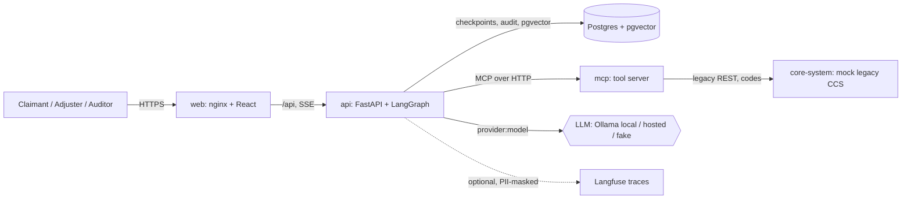
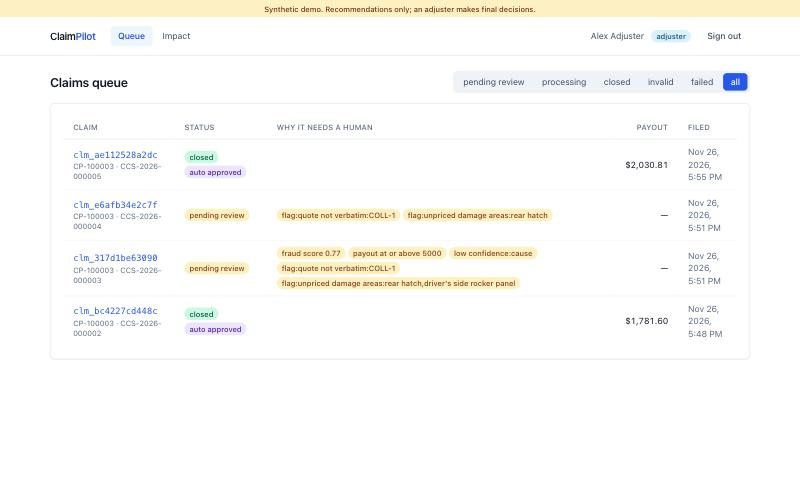
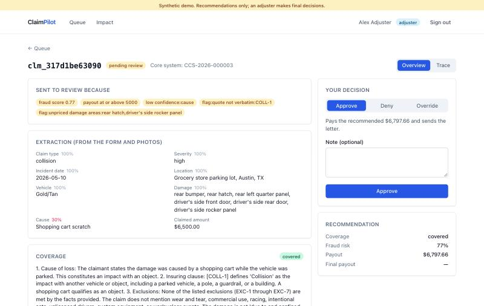
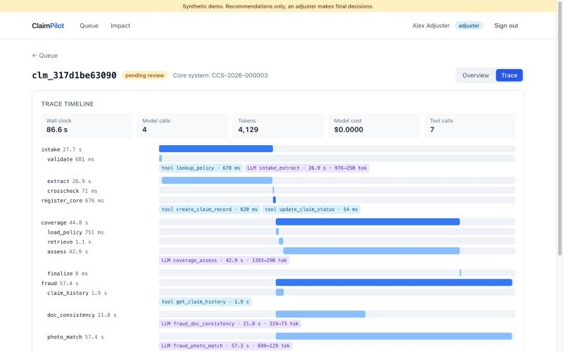
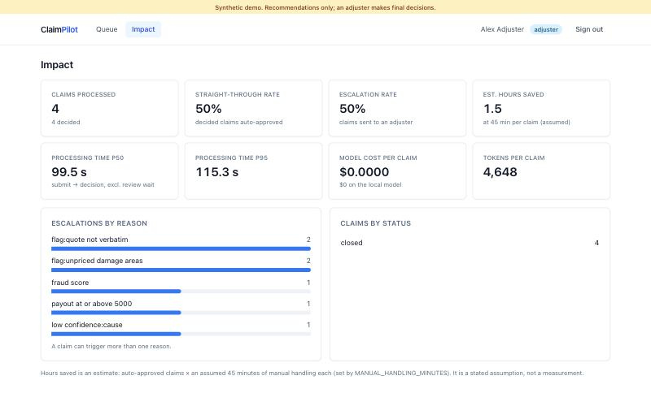
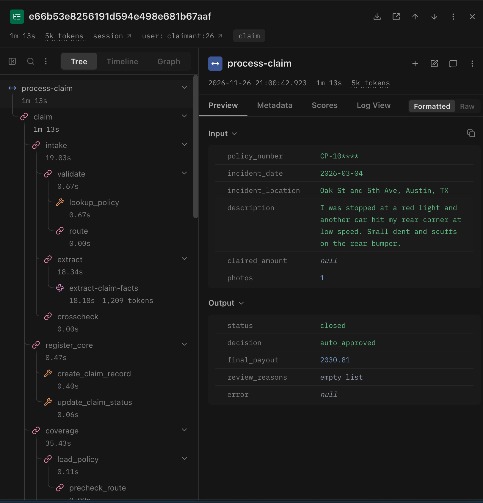
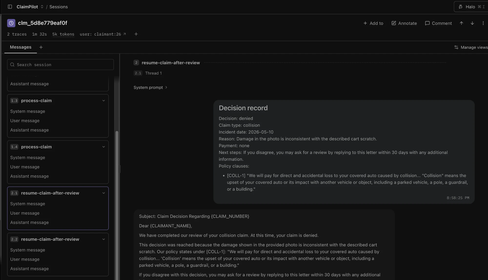

# ClaimPilot

Multi-agent processing for personal **auto** insurance claims. It reads the claim form and damage photos, checks coverage against the policy wording with clause citations, runs fraud checks in parallel, calculates the payout in code, sends risky claims to an adjuster, and drafts the decision letter. Built with LangGraph, FastAPI, Postgres + pgvector, an MCP server in front of a legacy core system, and React.

> **Synthetic demo.** All data is synthetic. The system only makes recommendations; an adjuster makes final decisions.

> **AI assistance.** Claude (Anthropic) was used as a coding assistant during development and testing.

## The problem
Claim handlers spend much of each claim on routine reading and lookups: matching the story to the photos, finding the right policy clause, pulling claim history and repair prices, working out the deductible, writing the letter. Most claims are simple, so this is slow, repetitive work. The risky few still need a human, with the evidence laid out.

ClaimPilot closes simple, clean claims straight through and routes everything else to an adjuster with the reasons and evidence attached. Every step is audited.

## How a claim flows
| Step | What happens | Done by |
|---|---|---|
| Intake | Validate the form and policy; extract the facts and damage severity from text **and photos**; cross-check them | LLM (vision) + rules |
| Register | Create the claim in the legacy core system through the MCP server (anti-corruption layer) | Code |
| Coverage ‖ Fraud | *In parallel.* Coverage: retrieve clauses (pgvector) → decide covered / not covered / ambiguous, quoting the clause. Fraud: document consistency, photo-vs-story match, claim history → one score | LLM + RAG; rules for history |
| Payout | Lowest repair quote vs vehicle value (ACV), deductible, total-loss rule | **Code only** (no LLM arithmetic) |
| Review gate | Auto-approve only if covered, fraud < 0.6, payout < $5,000, confident extraction and no check flags; otherwise pause for an adjuster (approve / deny / override, with a reason) | Code + human |
| Letter | Draft → independent review → one revision. Amounts and claim numbers are filled in by code, so the model can't misstate them. A letter that still fails is never sent: the claim pauses until an adjuster fixes it | LLM + code checks + human |
| Close | Update the core system, write the audit trail | Code |

## Architecture

- **Orchestration:** a LangGraph parent graph with subgraphs for intake, coverage, fraud and letters. Coverage and fraud fan out in parallel. The review gate is a LangGraph `interrupt()` with a Postgres checkpointer, so a paused claim survives restarts.
- **Integration:** the agents never call the core system directly. The MCP server maps legacy codes and string amounts to typed results ([ADR-0003](docs/adr/0003-mcp-integration-layer.md)).
- **Control:** routing, payout and letter amounts are deterministic code ([ADR-0001](docs/adr/0001-deterministic-routing.md), [ADR-0004](docs/adr/0004-review-gate-and-letters.md)). The LLM reads and writes; code decides.
- **Audit and privacy:** every node, model call (model, tokens, latency, cost), tool call and human decision goes to an ordered audit trail, with PII redacted before storage, streaming and tracing.
- **Provider-neutral:** each node's model is a `provider:model` setting. Switching from fake → local → hosted is an `.env` change ([ADR-0002](docs/adr/0002-llm-access-layer.md)).

## Results
Local model `ollama:gemma4:12b` (text + vision), $0 per claim. Full tables: [evals/report.md](evals/report.md).

| Eval | Set | Result | Target |
|---|---|---|---|
| Coverage decision accuracy | held-out, 24 cases | **100%** | ≥ 80% |
| Safe-escalation recall (risky claims sent to a human) | held-out | **100%**, 0 false auto-approvals | ≥ 95% |
| Citation correctness | dev 30 / held-out 24 | 100% / **92%** | ≥ 90% |
| Photo severity | validation, 24 photos | 92% exact, 100% within one level | — |
| Decision letters | 12 cases | 100% correct decision and amount, 0 flagged; 11 of 12 pass on the first draft | 100% |

- **End to end on a laptop (M1 Pro):** about 70 s to reach the review gate, plus about 15 s for the letter. In fake mode a claim takes about 1 s.
- **Not done yet:** an eval on a second (hosted) provider, which needs paid API keys. See Limitations.

## Screenshots
| Adjuster queue | Claim detail |
|---|---|
|  |  |
| **Trace timeline** | **Impact dashboard** |
|  |  |

## Run it (Docker)
Prerequisite: Docker. No API key needed.

```bash
cp .env.example .env
docker compose up -d --build
docker compose run --rm api python -m claimpilot.seed
```

Open http://localhost:8080 and sign in as one of the demo users below. Model calls run in `fake` mode by default (canned answers, $0). To use the real local model, run Ollama on the host with `ollama pull gemma4:12b`, then:

```bash
LLM_MODE=live docker compose up -d
```

### Demo users (synthetic)
| Role | Email | Can |
|---|---|---|
| Claimant | `casey.fofana@example.com` (policy CP-100003) | file claims, see own status and letter |
| Adjuster | `adjuster@claimpilot.example`, `adjuster2@claimpilot.example` | queue (all / mine / unassigned), assign, approve / deny / override, fix flagged letters, trace, impact |
| Auditor | `auditor@claimpilot.example` | read-only: all claims, audit, impact |

Password for all: `claimpilot-demo` locally. Set `DEMO_PASSWORD` before seeding any shared deployment.

## Develop
Prerequisites: [uv](https://docs.astral.sh/uv/), Node 20+, Docker (for Postgres).

```bash
docker compose up -d db
cd backend && uv sync && uv run alembic upgrade head && uv run python -m claimpilot.seed
uv run uvicorn claimpilot.api.main:app --reload   # http://localhost:8000/docs
```

In a second terminal (Vite proxies `/api` to port 8000):

```bash
cd frontend && npm install && npm run dev        # http://localhost:5173
```

Tests (no API key; the DB tests skip without Postgres):

```bash
cd backend && uv run pytest
cd frontend && npm test
scripts/smoke.sh                                 # API end-to-end check against the running Docker stack
cd frontend && npm run e2e                       # Playwright browser tests against the same stack
```

CI (GitHub Actions, no API keys) runs three jobs:
- **backend:** ruff, plus pytest against a Postgres + pgvector service; the job fails if the DB tests skip.
- **frontend:** type check, lint with zero warnings, vitest and the production build.
- **stack:** builds the images, runs `docker compose`, seeds, then runs the smoke test (claim → audit trail → PII check) and the Playwright browser tests.

### LLM tiers (zero-cost development)
| `LLM_MODE` | What it does | Cost |
|---|---|---|
| `fake` | Canned per-node responses (tests, CI, UI) | $0 |
| `replay` | Serves responses recorded earlier | $0 |
| `record` | Calls the real model and saves responses | per call |
| `live` | Calls the real model | per call |

Evals: `uv run python -m claimpilot.evals.coverage|severity|letters` (`LLM_MODE=record`), which write [evals/report.md](evals/report.md).

### API
`/auth/login`, `/auth/me`, `POST /claims` (multipart: `form` JSON + `photos`), `GET /claims`, `GET /claims/{id}`, `POST /claims/{id}/review`, `GET /claims/{id}/events` (SSE), `GET /claims/{id}/audit`, `GET /metrics`. OpenAPI docs at `/docs`.

## Observability (Langfuse)
Optional. Set `LANGFUSE_PUBLIC_KEY`, `LANGFUSE_SECRET_KEY` and `LANGFUSE_HOST` in `.env` (the free cloud tier works); `TRACING=false` turns it off. Tracing follows Langfuse's [best practices](https://langfuse.com/docs/observability/best-practices):
- **One trace per run segment:** `process-claim`, `resume-claim-after-review`, `finish-claim-after-letter-edit`. A claim's segments form a **session** (`session_id` = claim id), because human review pauses the workflow between them. `user_id` is the pseudonymous claimant id.
- **Steps nested as they ran:** LangGraph nodes and subgraphs, `generation`s named by action (`extract-claim-facts`, `assess-coverage`, `write-letter`, …) with model and tokens, a `retriever` for clause search, and MCP `tool` calls.
- **Inputs and outputs:** each trace's input is the claim form or the adjuster's action, and its output is the resulting decision. Photos are attached as media, and framework plumbing is filtered out.
- **PII:** masked at export (`mask_otel_spans`), using patterns plus the claimant's known values. Policy numbers are partly masked.
- **Evals:** one trace per case and one session per eval run. Expected values are stored in metadata (ready for LLM-as-a-judge), and each result row stores its `trace_id`. Eval traffic uses `environment=eval`.

| One claim run as a trace (masked policy number, readable input/output) | A claim as a session: the second trace resumes after the adjuster's decision |
|---|---|
|  |  |

## Deploying to AWS
Terraform for ECS Fargate, ALB, RDS (pgvector), EFS, Secrets Manager and a budget alarm is in [infra/aws](infra/aws/README.md). It is written but **not applied**; the demo runs on Docker Compose ([ADR-0005](docs/adr/0005-cloud-target-aws.md)).

## Limitations
- **Synthetic data only.** Policies are seeded from a public CC0 dataset ([docs/data-sources.md](docs/data-sources.md)); the photos are openly licensed, and their attribution is in `data/photos/ATTRIBUTION.md`.
- **One model family evaluated.** The second-provider comparison in the requirements still needs paid API keys.
- **Citations:** held-out citation correctness went from 83% to 92%. The fix is a deterministic rule: a "covered" decision always cites its part's insuring clause, and the other part's insuring clause is dropped. It was rescored on the recorded model outputs, and that held-out set had already been seen during prompt work, so treat 92% as optimistic until a fresh set is labeled.
- **Single API replica:** live progress fan-out is in-process.
- **Photos are on a local or EFS volume.** S3 with presigned uploads is the production path. Prompt caching applies only to hosted providers.
- There is no self-signup or password reset (out of scope).
- **Hours saved** on the dashboard is an estimate built on a stated assumption: 45 minutes of manual handling per auto-approved claim.

## More
- Requirements and acceptance criteria: [docs/requirements.md](docs/requirements.md)
- Decisions: [docs/adr/](docs/adr/)
- Case summary: [docs/case-summary.md](docs/case-summary.md) · demo video script: [docs/demo-script.md](docs/demo-script.md)

## Layout
```
backend/     FastAPI + LangGraph (uv project): graphs, llm layer, MCP server, mock core system, evals
frontend/    React + TypeScript (Vite, TanStack Query, Tailwind), nginx config
infra/       Postgres init, AWS Terraform (not applied)
data/        policy forms, licensed photos (raw third-party data stays local, gitignored)
evals/       labeled eval sets and report
docs/        requirements, ADRs, data sources, case summary, demo script, screenshots
```
